# Gallery

All **255** illustrations, CC0 (public domain). Click an image to open the SVG.

Levels: [A0](#level-a0) · [A1](#level-a1) · [A2](#level-a2) · [B1](#level-b1)

## Level A0

50 images

### Animals (6)

|   |   |   |   |   |   |
|---|---|---|---|---|---|
| <a href="images/svg/dog.svg">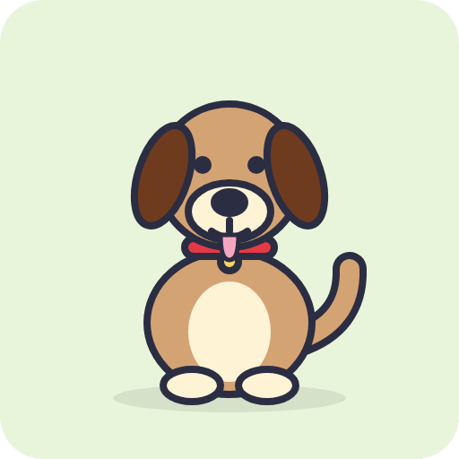</a> <b>dog</b> el perro · le chien · der Hund | <a href="images/svg/cat.svg">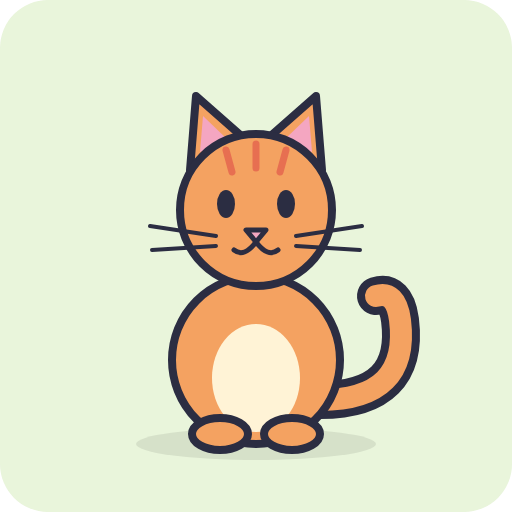</a> <b>cat</b> el gato · le chat · die Katze | <a href="images/svg/bird.svg">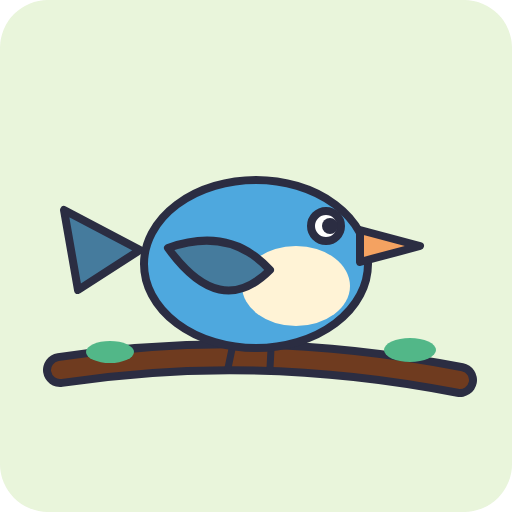</a> <b>bird</b> el pájaro · l'oiseau · der Vogel | <a href="images/svg/fish.svg">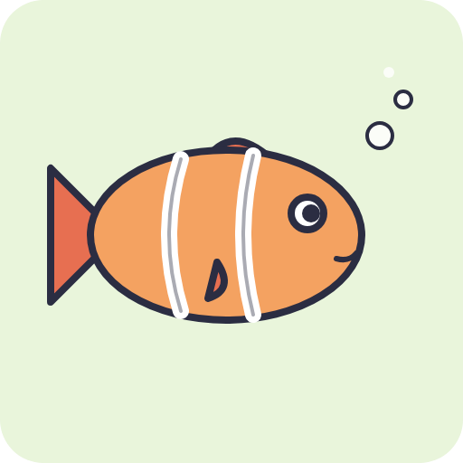</a> <b>fish</b> el pez · le poisson · der Fisch | <a href="images/svg/horse.svg">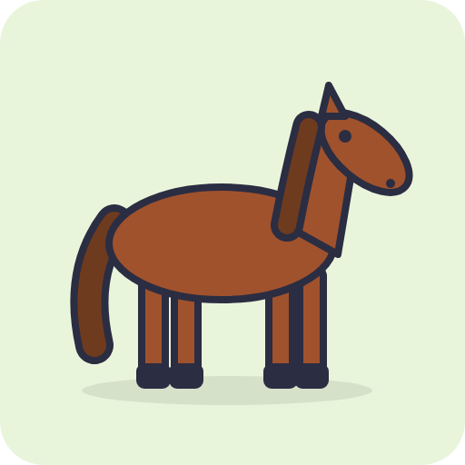</a> <b>horse</b> el caballo · le cheval · das Pferd | <a href="images/svg/cow.svg">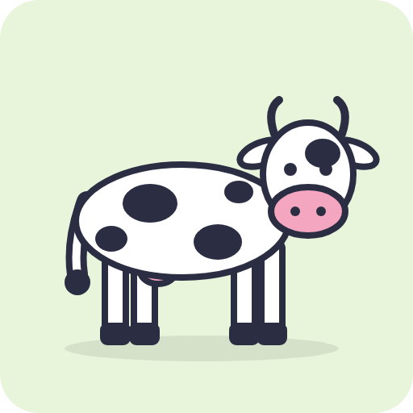</a> <b>cow</b> la vaca · la vache · die Kuh |

### Body (2)

|   |   |   |   |   |   |
|---|---|---|---|---|---|
| <a href="images/svg/hand.svg">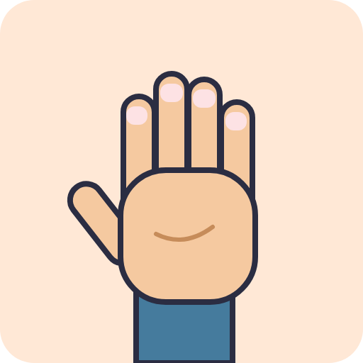</a> <b>hand</b> la mano · la main · die Hand | <a href="images/svg/eye.svg">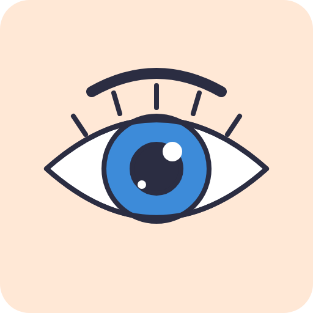</a> <b>eye</b> el ojo · l'œil · das Auge |   |   |   |   |

### Clothes (3)

|   |   |   |   |   |   |
|---|---|---|---|---|---|
| <a href="images/svg/hat.svg">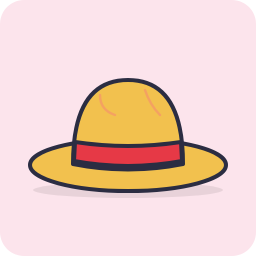</a> <b>hat</b> el sombrero · le chapeau · der Hut | <a href="images/svg/shoe.svg">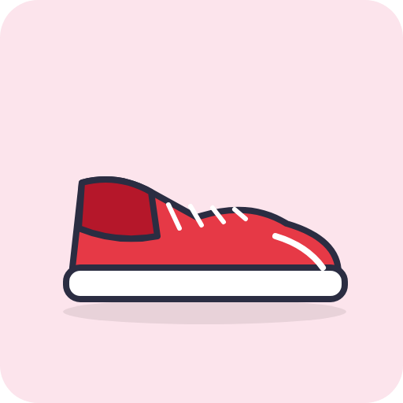</a> <b>shoe</b> el zapato · la chaussure · der Schuh | <a href="images/svg/shirt.svg">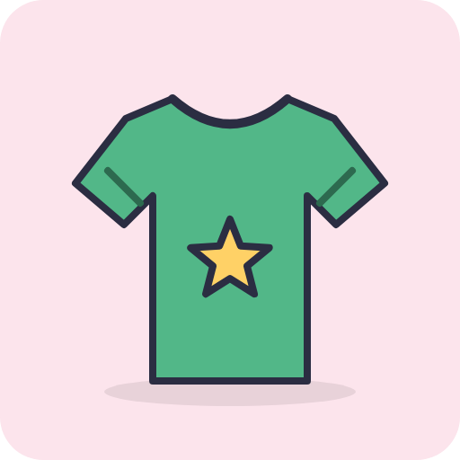</a> <b>shirt</b> la camiseta · le t-shirt · das T-Shirt |   |   |   |

### Food (7)

|   |   |   |   |   |   |
|---|---|---|---|---|---|
| <a href="images/svg/apple.svg">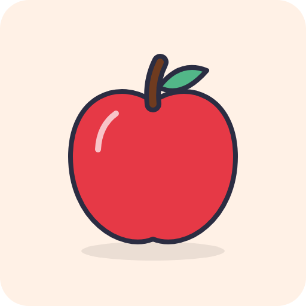</a> <b>apple</b> la manzana · la pomme · der Apfel | <a href="images/svg/banana.svg">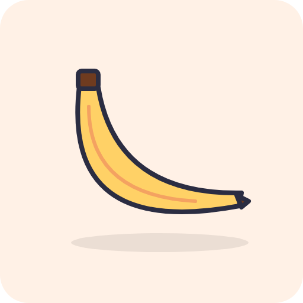</a> <b>banana</b> el plátano · la banane · die Banane | <a href="images/svg/bread.svg">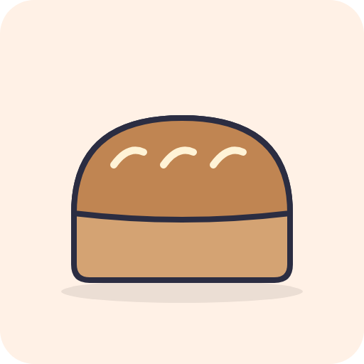</a> <b>bread</b> el pan · le pain · das Brot | <a href="images/svg/egg.svg">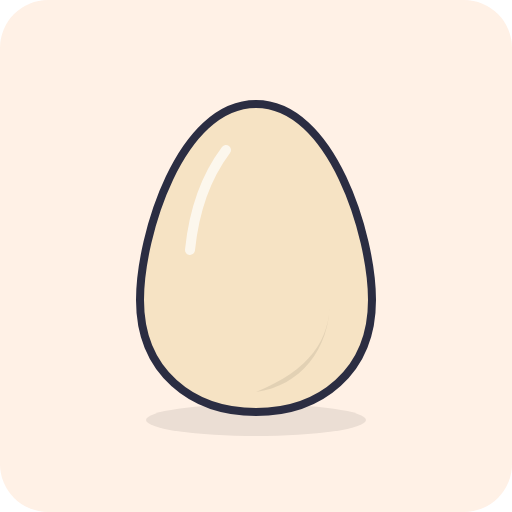</a> <b>egg</b> el huevo · l'œuf · das Ei | <a href="images/svg/milk.svg">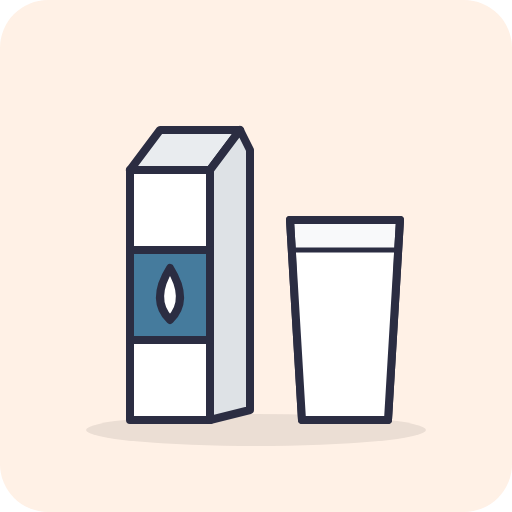</a> <b>milk</b> la leche · le lait · die Milch | <a href="images/svg/water.svg">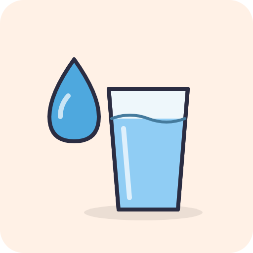</a> <b>water</b> el agua · l'eau · das Wasser |
|  <b>cake</b> el pastel · le gâteau · der Kuchen |   |   |   |   |   |

### Home (7)

|   |   |   |   |   |   |
|---|---|---|---|---|---|
| <a href="images/svg/house.svg">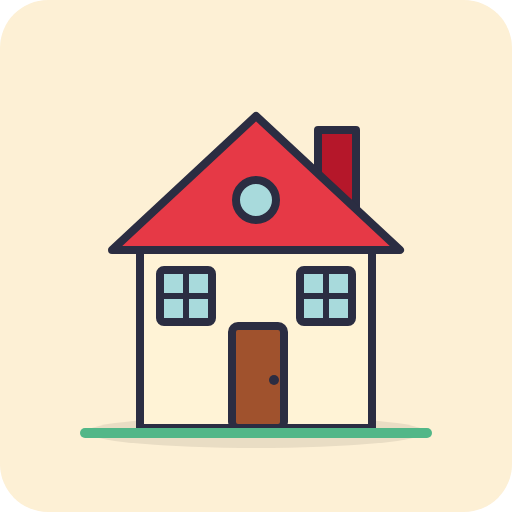</a> <b>house</b> la casa · la maison · das Haus | <a href="images/svg/door.svg">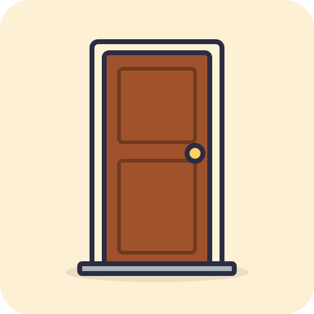</a> <b>door</b> la puerta · la porte · die Tür | <a href="images/svg/window.svg">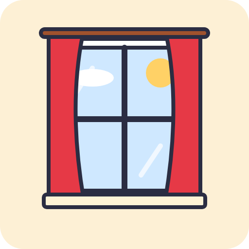</a> <b>window</b> la ventana · la fenêtre · das Fenster | <a href="images/svg/bed.svg">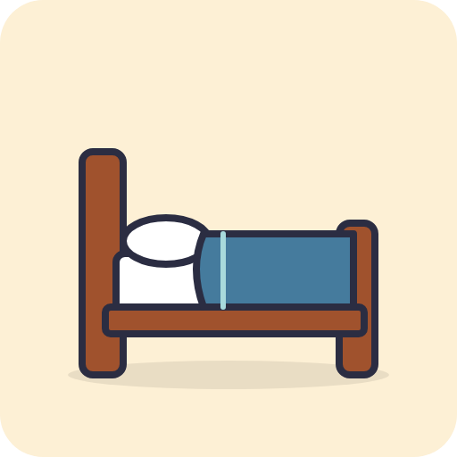</a> <b>bed</b> la cama · le lit · das Bett | <a href="images/svg/chair.svg">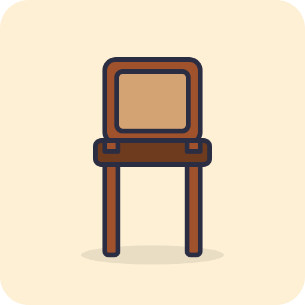</a> <b>chair</b> la silla · la chaise · der Stuhl | <a href="images/svg/table.svg">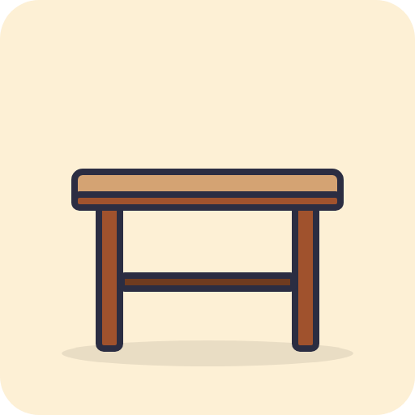</a> <b>table</b> la mesa · la table · der Tisch |
| <a href="images/svg/lamp.svg">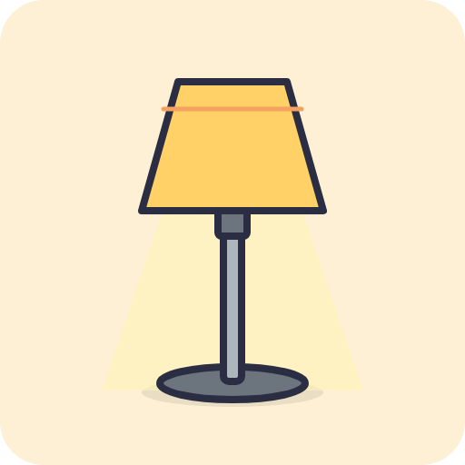</a> <b>lamp</b> la lámpara · la lampe · die Lampe |   |   |   |   |   |

### Nature (6)

|   |   |   |   |   |   |
|---|---|---|---|---|---|
| <a href="images/svg/sun.svg">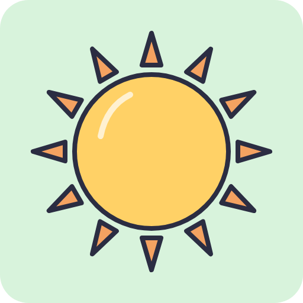</a> <b>sun</b> el sol · le soleil · die Sonne |  <b>moon</b> la luna · la lune · der Mond |  <b>star</b> la estrella · l'étoile · der Stern | <a href="images/svg/tree.svg">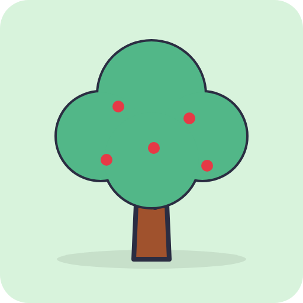</a> <b>tree</b> el árbol · l'arbre · der Baum | <a href="images/svg/flower.svg">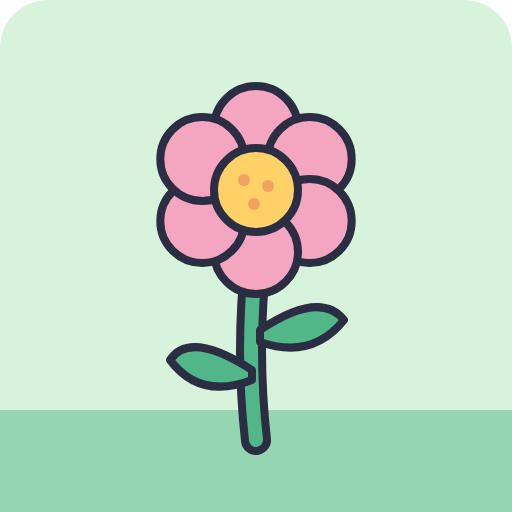</a> <b>flower</b> la flor · la fleur · die Blume | <a href="images/svg/cloud.svg">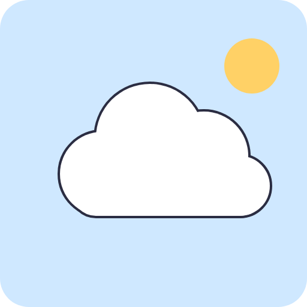</a> <b>cloud</b> la nube · le nuage · die Wolke |

### People (5)

|   |   |   |   |   |   |
|---|---|---|---|---|---|
| <a href="images/svg/boy.svg">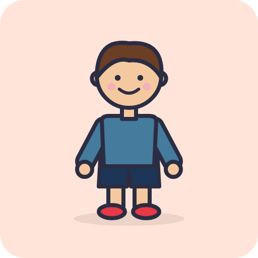</a> <b>boy</b> el niño · le garçon · der Junge | <a href="images/svg/girl.svg">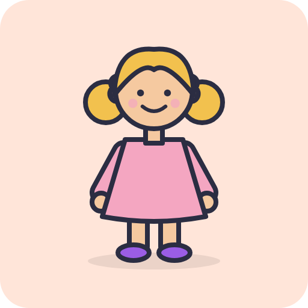</a> <b>girl</b> la niña · la fille · das Mädchen | <a href="images/svg/man.svg">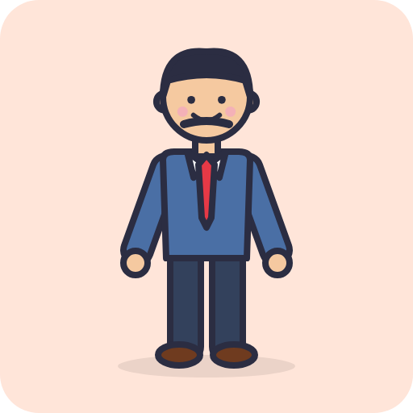</a> <b>man</b> el hombre · l'homme · der Mann | <a href="images/svg/woman.svg">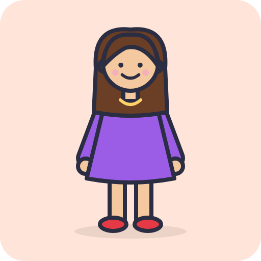</a> <b>woman</b> la mujer · la femme · die Frau | <a href="images/svg/baby.svg">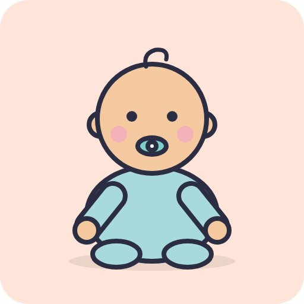</a> <b>baby</b> el bebé · le bébé · das Baby |   |

### School (2)

|   |   |   |   |   |   |
|---|---|---|---|---|---|
|  <b>book</b> el libro · le livre · das Buch | <a href="images/svg/pen.svg">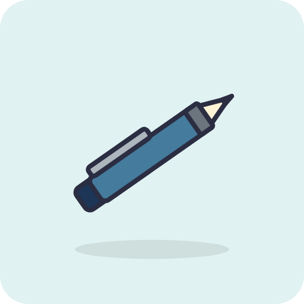</a> <b>pen</b> el bolígrafo · le stylo · der Kuli |   |   |   |   |

### Things (6)

|   |   |   |   |   |   |
|---|---|---|---|---|---|
| <a href="images/svg/ball.svg">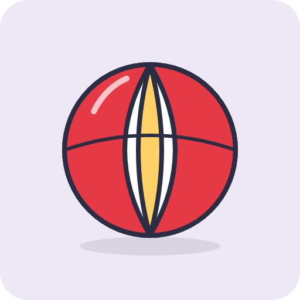</a> <b>ball</b> la pelota · le ballon · der Ball | <a href="images/svg/phone.svg">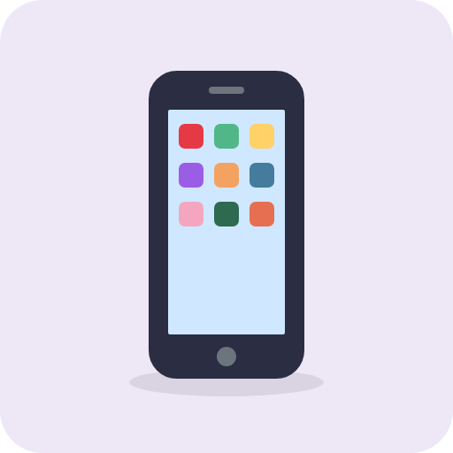</a> <b>phone</b> el teléfono · le téléphone · das Handy | <a href="images/svg/cup.svg">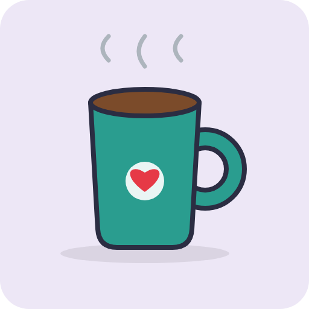</a> <b>cup</b> la taza · la tasse · die Tasse |  <b>key</b> la llave · la clé · der Schlüssel | <a href="images/svg/bag.svg">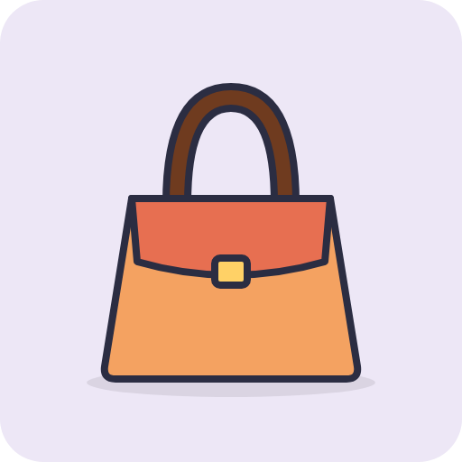</a> <b>bag</b> el bolso · le sac · die Tasche | <a href="images/svg/clock.svg">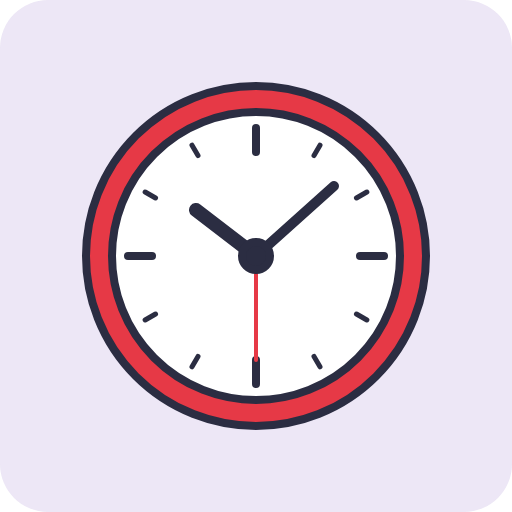</a> <b>clock</b> el reloj · l'horloge · die Uhr |

### Transport (6)

|   |   |   |   |   |   |
|---|---|---|---|---|---|
| <a href="images/svg/car.svg">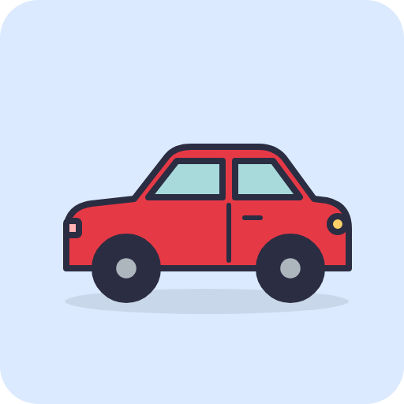</a> <b>car</b> el coche · la voiture · das Auto | <a href="images/svg/bus.svg">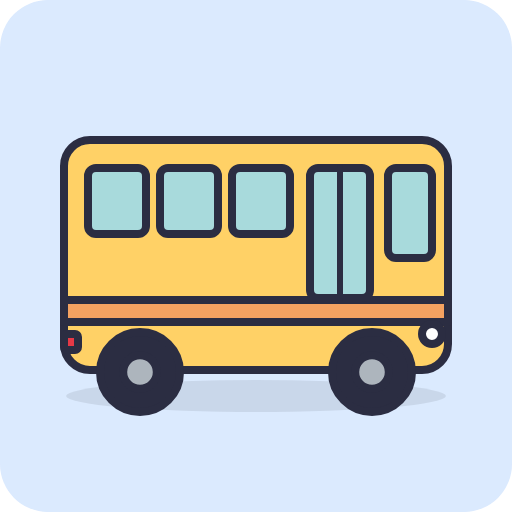</a> <b>bus</b> el autobús · le bus · der Bus | <a href="images/svg/bike.svg">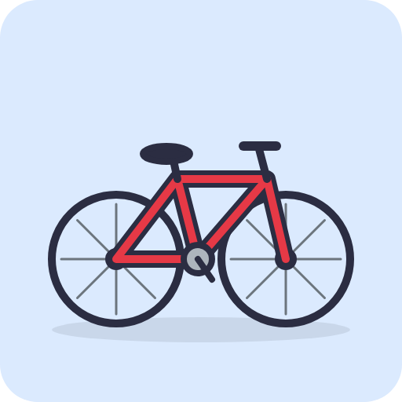</a> <b>bike</b> la bicicleta · le vélo · das Fahrrad | <a href="images/svg/boat.svg">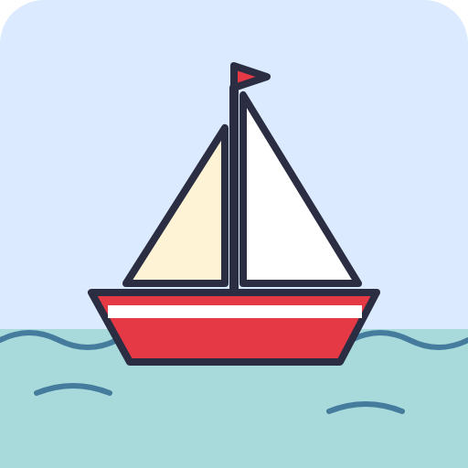</a> <b>boat</b> el barco · le bateau · das Boot | <a href="images/svg/train.svg">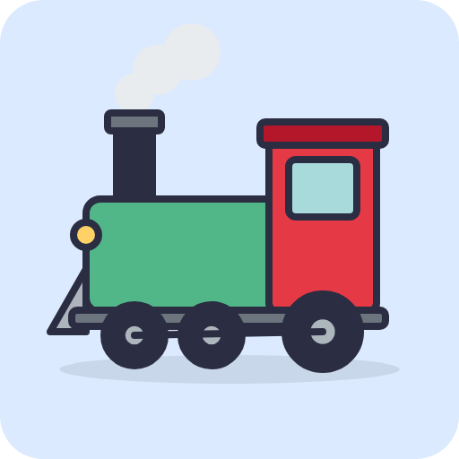</a> <b>train</b> el tren · le train · der Zug |  <b>plane</b> el avión · l'avion · das Flugzeug |

## Level A1

50 images

### Animals (8)

|   |   |   |   |   |   |
|---|---|---|---|---|---|
| <a href="images/svg/pig.svg">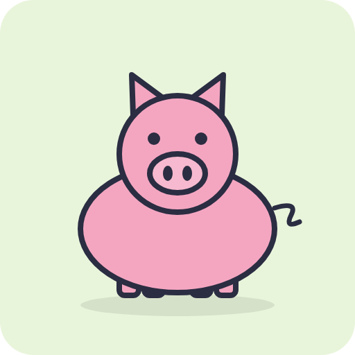</a> <b>pig</b> el cerdo · le cochon · das Schwein | <a href="images/svg/sheep.svg">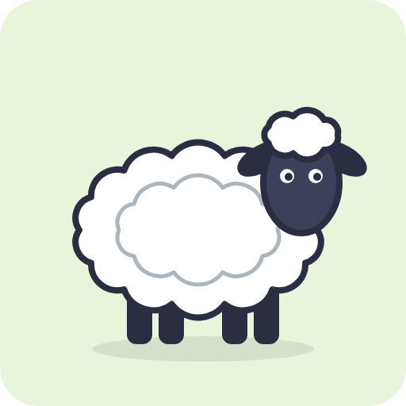</a> <b>sheep</b> la oveja · le mouton · das Schaf | <a href="images/svg/duck.svg">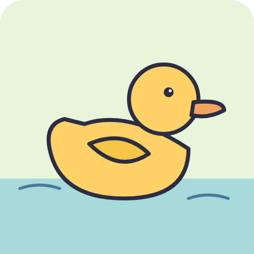</a> <b>duck</b> el pato · le canard · die Ente | <a href="images/svg/rabbit.svg">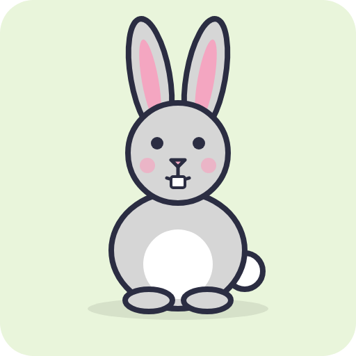</a> <b>rabbit</b> el conejo · le lapin · das Kaninchen | <a href="images/svg/elephant.svg">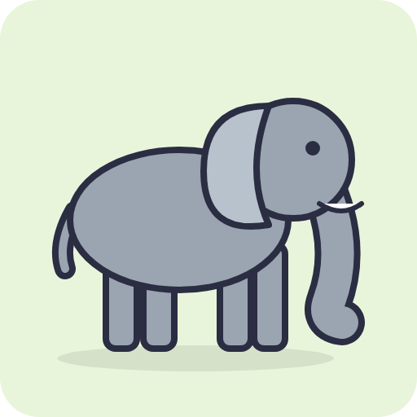</a> <b>elephant</b> el elefante · l'éléphant · der Elefant | <a href="images/svg/lion.svg">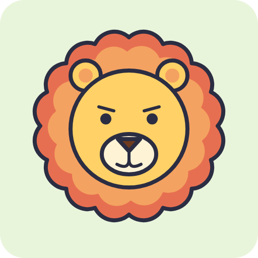</a> <b>lion</b> el león · le lion · der Löwe |
|  <b>frog</b> la rana · la grenouille · der Frosch |  <b>butterfly</b> la mariposa · le papillon · der Schmetterling |   |   |   |   |

### Body (5)

|   |   |   |   |   |   |
|---|---|---|---|---|---|
|  <b>nose</b> la nariz · le nez · die Nase |  <b>mouth</b> la boca · la bouche · der Mund |  <b>ear</b> la oreja · l'oreille · das Ohr |  <b>foot</b> el pie · le pied · der Fuß |  <b>tooth</b> el diente · la dent · der Zahn |   |

### Clothes (4)

|   |   |   |   |   |   |
|---|---|---|---|---|---|
|  <b>dress</b> el vestido · la robe · das Kleid |  <b>sock</b> el calcetín · la chaussette · die Socke |  <b>trousers</b> los pantalones · le pantalon · die Hose |  <b>scarf</b> la bufanda · l'écharpe · der Schal |   |   |

### Food (8)

|   |   |   |   |   |   |
|---|---|---|---|---|---|
|  <b>orange</b> la naranja · l'orange · die Orange |  <b>carrot</b> la zanahoria · la carotte · die Karotte |  <b>tomato</b> el tomate · la tomate · die Tomate |  <b>cheese</b> el queso · le fromage · der Käse |  <b>pizza</b> la pizza · la pizza · die Pizza |  <b>ice cream</b> el helado · la glace · das Eis |
|  <b>grapes</b> las uvas · le raisin · die Trauben |  <b>strawberry</b> la fresa · la fraise · die Erdbeere |   |   |   |   |

### Home (3)

|   |   |   |   |   |   |
|---|---|---|---|---|---|
|  <b>sofa</b> el sofá · le canapé · das Sofa |  <b>television</b> la televisión · la télévision · der Fernseher |  <b>computer</b> el ordenador · l'ordinateur · der Computer |   |   |   |

### Nature (7)

|   |   |   |   |   |   |
|---|---|---|---|---|---|
|  <b>mountain</b> la montaña · la montagne · der Berg |  <b>sea</b> el mar · la mer · das Meer |  <b>rain</b> la lluvia · la pluie · der Regen |  <b>snow</b> la nieve · la neige · der Schnee |  <b>rainbow</b> el arcoíris · l'arc-en-ciel · der Regenbogen |  <b>leaf</b> la hoja · la feuille · das Blatt |
|  <b>fire</b> el fuego · le feu · das Feuer |   |   |   |   |   |

### School (2)

|   |   |   |   |   |   |
|---|---|---|---|---|---|
|  <b>pencil</b> el lápiz · le crayon · der Bleistift |  <b>scissors</b> las tijeras · les ciseaux · die Schere |   |   |   |   |

### Things (10)

|   |   |   |   |   |   |
|---|---|---|---|---|---|
|  <b>umbrella</b> el paraguas · le parapluie · der Regenschirm |  <b>glasses</b> las gafas · les lunettes · die Brille |  <b>plate</b> el plato · l'assiette · der Teller |  <b>spoon</b> la cuchara · la cuillère · der Löffel |  <b>fork</b> el tenedor · la fourchette · die Gabel |  <b>bottle</b> la botella · la bouteille · die Flasche |
|  <b>guitar</b> la guitarra · la guitare · die Gitarre |  <b>kite</b> la cometa · le cerf-volant · der Drachen |  <b>gift</b> el regalo · le cadeau · das Geschenk |  <b>balloon</b> el globo · le ballon de baudruche · der Luftballon |   |   |

### Transport (3)

|   |   |   |   |   |   |
|---|---|---|---|---|---|
|  <b>truck</b> el camión · le camion · der Lastwagen |  <b>helicopter</b> el helicóptero · l'hélicoptère · der Hubschrauber |  <b>motorbike</b> la moto · la moto · das Motorrad |   |   |   |

## Level A2

86 images

### Animals (12)

|   |   |   |   |   |   |
|---|---|---|---|---|---|
|  <b>giraffe</b> la jirafa · la girafe · die Giraffe |  <b>zebra</b> la cebra · le zèbre · das Zebra |  <b>monkey</b> el mono · le singe · der Affe |  <b>penguin</b> el pingüino · le manchot · der Pinguin |  <b>snake</b> la serpiente · le serpent · die Schlange |  <b>turtle</b> la tortuga · la tortue · die Schildkröte |
|  <b>whale</b> la ballena · la baleine · der Wal |  <b>shark</b> el tiburón · le requin · der Hai |  <b>owl</b> el búho · le hibou · die Eule |  <b>bee</b> la abeja · l'abeille · die Biene |  <b>spider</b> la araña · l'araignée · die Spinne |  <b>camel</b> el camello · le chameau · das Kamel |

### Food (13)

|   |   |   |   |   |   |
|---|---|---|---|---|---|
|  <b>sandwich</b> el sándwich · le sandwich · das Sandwich |  <b>soup</b> la sopa · la soupe · die Suppe |  <b>salad</b> la ensalada · la salade · der Salat |  <b>rice</b> el arroz · le riz · der Reis |  <b>noodles</b> los fideos · les nouilles · die Nudeln |  <b>chocolate</b> el chocolate · le chocolat · die Schokolade |
|  <b>honey</b> la miel · le miel · der Honig |  <b>lemon</b> el limón · le citron · die Zitrone |  <b>potato</b> la patata · la pomme de terre · die Kartoffel |  <b>onion</b> la cebolla · l'oignon · die Zwiebel |  <b>mushroom</b> la seta · le champignon · der Pilz |  <b>watermelon</b> la sandía · la pastèque · die Wassermelone |
|  <b>pineapple</b> la piña · l'ananas · die Ananas |   |   |   |   |   |

### Home (10)

|   |   |   |   |   |   |
|---|---|---|---|---|---|
|  <b>mirror</b> el espejo · le miroir · der Spiegel |  <b>pillow</b> la almohada · l'oreiller · das Kissen |  <b>blanket</b> la manta · la couverture · die Decke |  <b>towel</b> la toalla · la serviette · das Handtuch |  <b>soap</b> el jabón · le savon · die Seife |  <b>oven</b> el horno · le four · der Ofen |
|  <b>kettle</b> el hervidor · la bouilloire · der Wasserkocher |  <b>teapot</b> la tetera · la théière · die Teekanne |  <b>fridge</b> la nevera · le frigo · der Kühlschrank |  <b>microwave</b> el microondas · le micro-ondes · die Mikrowelle |   |   |

### Jobs (7)

|   |   |   |   |   |   |
|---|---|---|---|---|---|
|  <b>doctor</b> el médico · le médecin · der Arzt |  <b>teacher</b> la profesora · la professeure · die Lehrerin |  <b>police officer</b> el policía · le policier · der Polizist |  <b>firefighter</b> el bombero · le pompier · der Feuerwehrmann |  <b>chef</b> el cocinero · le cuisinier · der Koch |  <b>farmer</b> el granjero · l'agriculteur · der Bauer |
|  <b>nurse</b> la enfermera · l'infirmière · die Krankenschwester |   |   |   |   |   |

### Music (5)

|   |   |   |   |   |   |
|---|---|---|---|---|---|
|  <b>piano</b> el piano · le piano · das Klavier |  <b>violin</b> el violín · le violon · die Geige |  <b>drum</b> el tambor · le tambour · die Trommel |  <b>microphone</b> el micrófono · le micro · das Mikrofon |  <b>headphones</b> los auriculares · le casque · die Kopfhörer |   |

### Places (10)

|   |   |   |   |   |   |
|---|---|---|---|---|---|
|  <b>bridge</b> el puente · le pont · die Brücke |  <b>castle</b> el castillo · le château · die Burg |  <b>forest</b> el bosque · la forêt · der Wald |  <b>desert</b> el desierto · le désert · die Wüste |  <b>island</b> la isla · l'île · die Insel |  <b>volcano</b> el volcán · le volcan · der Vulkan |
|  <b>lighthouse</b> el faro · le phare · der Leuchtturm |  <b>farm</b> la granja · la ferme · der Bauernhof |  <b>tent</b> la tienda de campaña · la tente · das Zelt |  <b>beach</b> la playa · la plage · der Strand |   |   |

### School (2)

|   |   |   |   |   |   |
|---|---|---|---|---|---|
|  <b>magnet</b> el imán · l'aimant · der Magnet |  <b>globe</b> el globo terráqueo · le globe · der Globus |   |   |   |   |

### Things (19)

|   |   |   |   |   |   |
|---|---|---|---|---|---|
|  <b>camera</b> la cámara · l'appareil photo · die Kamera |  <b>wallet</b> la cartera · le portefeuille · die Geldbörse |  <b>passport</b> el pasaporte · le passeport · der Reisepass |  <b>ticket</b> el billete · le billet · die Fahrkarte |  <b>map</b> el mapa · la carte · die Landkarte |  <b>compass</b> la brújula · la boussole · der Kompass |
|  <b>backpack</b> la mochila · le sac à dos · der Rucksack |  <b>suitcase</b> la maleta · la valise · der Koffer |  <b>hammer</b> el martillo · le marteau · der Hammer |  <b>ladder</b> la escalera de mano · l'échelle · die Leiter |  <b>bucket</b> el cubo · le seau · der Eimer |  <b>brush</b> el pincel · le pinceau · der Pinsel |
|  <b>lightbulb</b> la bombilla · l'ampoule · die Glühbirne |  <b>battery</b> la pila · la pile · die Batterie |  <b>calendar</b> el calendario · le calendrier · der Kalender |  <b>envelope</b> el sobre · l'enveloppe · der Briefumschlag |  <b>newspaper</b> el periódico · le journal · die Zeitung |  <b>candle</b> la vela · la bougie · die Kerze |
|  <b>trophy</b> el trofeo · le trophée · die Trophäe |   |   |   |   |   |

### Transport (8)

|   |   |   |   |   |   |
|---|---|---|---|---|---|
|  <b>airport</b> el aeropuerto · l'aéroport · der Flughafen |  <b>ambulance</b> la ambulancia · l'ambulance · der Krankenwagen |  <b>tractor</b> el tractor · le tracteur · der Traktor |  <b>submarine</b> el submarino · le sous-marin · das U-Boot |  <b>taxi</b> el taxi · le taxi · das Taxi |  <b>rocket</b> el cohete · la fusée · die Rakete |
|  <b>ship</b> el buque · le navire · das Schiff |  <b>anchor</b> el ancla · l'ancre · der Anker |   |   |   |   |

## Level B1

69 images

### Animals (12)

|   |   |   |   |   |   |
|---|---|---|---|---|---|
|  <b>kangaroo</b> el canguro · le kangourou · das Känguru |  <b>koala</b> el koala · le koala · der Koala |  <b>parrot</b> el loro · le perroquet · der Papagei |  <b>dolphin</b> el delfín · le dauphin · der Delfin |  <b>octopus</b> el pulpo · la pieuvre · der Oktopus |  <b>crab</b> el cangrejo · le crabe · die Krabbe |
|  <b>jellyfish</b> la medusa · la méduse · die Qualle |  <b>squirrel</b> la ardilla · l'écureuil · das Eichhörnchen |  <b>fox</b> el zorro · le renard · der Fuchs |  <b>wolf</b> el lobo · le loup · der Wolf |  <b>bear</b> el oso · l'ours · der Bär |  <b>deer</b> el ciervo · le cerf · der Hirsch |

### Clothes (10)

|   |   |   |   |   |   |
|---|---|---|---|---|---|
|  <b>jewellery</b> las joyas · les bijoux · der Schmuck |  <b>necklace</b> el collar · le collier · die Halskette |  <b>ring</b> el anillo · la bague · der Ring |  <b>bracelet</b> la pulsera · le bracelet · das Armband |  <b>pyjamas</b> el pijama · le pyjama · der Schlafanzug |  <b>raincoat</b> el impermeable · l'imperméable · der Regenmantel |
|  <b>boots</b> las botas · les bottes · die Stiefel |  <b>sandals</b> las sandalias · les sandales · die Sandalen |  <b>belt</b> el cinturón · la ceinture · der Gürtel |  <b>tie</b> la corbata · la cravate · die Krawatte |   |   |

### Health (7)

|   |   |   |   |   |   |
|---|---|---|---|---|---|
|  <b>wheelchair</b> la silla de ruedas · le fauteuil roulant · der Rollstuhl |  <b>crutches</b> las muletas · les béquilles · die Krücken |  <b>bandage</b> la tirita · le pansement · das Pflaster |  <b>thermometer</b> el termómetro · le thermomètre · das Thermometer |  <b>stethoscope</b> el estetoscopio · le stéthoscope · das Stethoskop |  <b>syringe</b> la jeringa · la seringue · die Spritze |
|  <b>pills</b> las pastillas · les comprimés · die Tabletten |   |   |   |   |   |

### Home (4)

|   |   |   |   |   |   |
|---|---|---|---|---|---|
|  <b>vacuum cleaner</b> la aspiradora · l'aspirateur · der Staubsauger |  <b>washing machine</b> la lavadora · la machine à laver · die Waschmaschine |  <b>iron</b> la plancha · le fer à repasser · das Bügeleisen |  <b>hairdryer</b> el secador · le sèche-cheveux · der Föhn |   |   |

### Nature (5)

|   |   |   |   |   |   |
|---|---|---|---|---|---|
|  <b>earthquake</b> el terremoto · le tremblement de terre · das Erdbeben |  <b>tornado</b> el tornado · la tornade · der Tornado |  <b>lightning</b> el relámpago · l'éclair · der Blitz |  <b>storm</b> la tormenta · l'orage · der Sturm |  <b>fog</b> la niebla · le brouillard · der Nebel |   |

### Places (15)

|   |   |   |   |   |   |
|---|---|---|---|---|---|
|  <b>skyscraper</b> el rascacielos · le gratte-ciel · der Wolkenkratzer |  <b>tunnel</b> el túnel · le tunnel · der Tunnel |  <b>harbour</b> el puerto · le port · der Hafen |  <b>factory</b> la fábrica · l'usine · die Fabrik |  <b>museum</b> el museo · le musée · das Museum |  <b>library</b> la biblioteca · la bibliothèque · die Bibliothek |
|  <b>stadium</b> el estadio · le stade · das Stadion |  <b>hospital</b> el hospital · l'hôpital · das Krankenhaus |  <b>pharmacy</b> la farmacia · la pharmacie · die Apotheke |  <b>bakery</b> la panadería · la boulangerie · die Bäckerei |  <b>supermarket</b> el supermercado · le supermarché · der Supermarkt |  <b>restaurant</b> el restaurante · le restaurant · das Restaurant |
|  <b>post office</b> la oficina de correos · la poste · die Post |  <b>police station</b> la comisaría · le commissariat · die Polizeiwache |  <b>fire station</b> el parque de bomberos · la caserne de pompiers · die Feuerwache |   |   |   |

### Science (7)

|   |   |   |   |   |   |
|---|---|---|---|---|---|
|  <b>laboratory</b> el laboratorio · le laboratoire · das Labor |  <b>microscope</b> el microscopio · le microscope · das Mikroskop |  <b>telescope</b> el telescopio · le télescope · das Teleskop |  <b>satellite</b> el satélite · le satellite · der Satellit |  <b>robot</b> el robot · le robot · der Roboter |  <b>solar panel</b> el panel solar · le panneau solaire · die Solaranlage |
|  <b>wind turbine</b> el aerogenerador · l'éolienne · das Windrad |   |   |   |   |   |

### Things (2)

|   |   |   |   |   |   |
|---|---|---|---|---|---|
|  <b>recycling bin</b> el contenedor de reciclaje · la poubelle de recyclage · die Recyclingtonne |  <b>perfume</b> el perfume · le parfum · das Parfüm |   |   |   |   |

### Tools (4)

|   |   |   |   |   |   |
|---|---|---|---|---|---|
|  <b>screwdriver</b> el destornillador · le tournevis · der Schraubenzieher |  <b>drill</b> el taladro · la perceuse · die Bohrmaschine |  <b>saw</b> la sierra · la scie · die Säge |  <b>wrench</b> la llave inglesa · la clé à molette · der Schraubenschlüssel |   |   |

### Transport (3)

|   |   |   |   |   |   |
|---|---|---|---|---|---|
|  <b>parachute</b> el paracaídas · le parachute · der Fallschirm |  <b>hot-air balloon</b> el globo aerostático · la montgolfière · der Heißluftballon |  <b>sailboard</b> la tabla de windsurf · la planche à voile · das Windsurfbrett |   |   |   |
