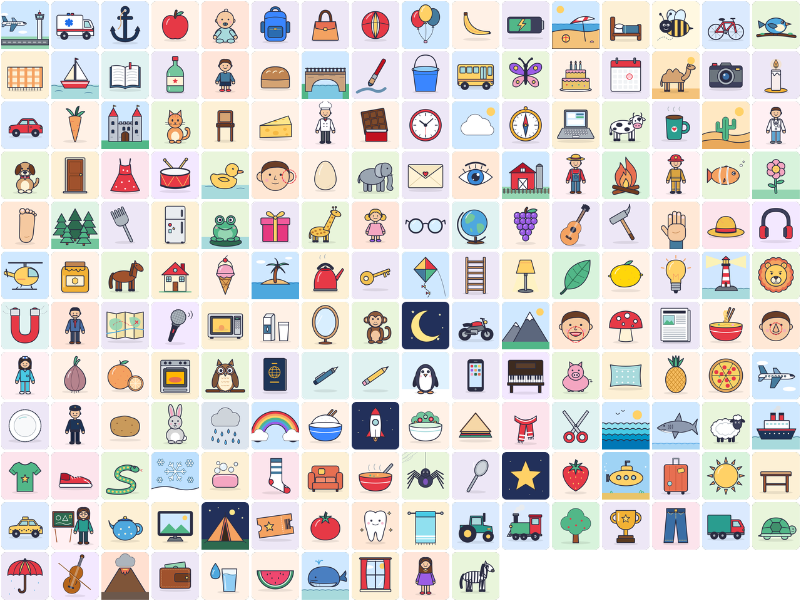

# FreewareStock Lite

**186 free, public-domain (CC0) illustrations of the most basic vocabulary, for language learning.**
Browse, search, download, or link to them from any app.



➡ **[See every image in the gallery](GALLERY.md)** (with translations)

## Open the browser

Open `index.html`. It works straight from disk (`file://`) or from any static host (GitHub Pages, Netlify, etc.):

```bash
python3 -m http.server 8000   # then visit http://localhost:8000
```

- **Search** by English word, tag, topic, or translation (`dog`, `perro`, `chien`, `Hund`, `animals`). Accents are ignored. Press `/` to focus the search box.
- **Filter** by CEFR level (A0, A1, A2, plus the planned B1 list) and by topic.
- **Click an image** to download SVG or PNG, or to copy its direct URL, CDN URL, an HTML `` embed or Markdown.
- **Deep links:** `index.html#dog` opens one image; `index.html?q=fruit` and `?level=A1` pre-fill filters.

## Levels

| Level | Status | Words |
|---|---|---|
| **A0** (first words) | ✅ 50 illustrated | boy, girl, man, woman, baby, house, door, window, bed, chair, table, lamp, car, bus, bike, boat, train, plane, dog, cat, bird, fish, horse, cow, apple, banana, bread, egg, milk, water, cake, sun, moon, star, tree, flower, cloud, ball, book, pen, phone, cup, key, bag, clock, hat, shoe, shirt, hand, eye |
| **A1** | ✅ 50 illustrated | pig, sheep, duck, rabbit, elephant, lion, frog, butterfly, orange, carrot, tomato, cheese, pizza, ice cream, grapes, strawberry, sofa, television, computer, umbrella, glasses, plate, spoon, fork, bottle, dress, sock, trousers, scarf, mountain, sea, rain, snow, rainbow, leaf, fire, truck, helicopter, motorbike, nose, mouth, ear, foot, tooth, pencil, scissors, guitar, kite, gift, balloon |
| **A2** | ✅ 86 illustrated | giraffe, zebra, monkey, penguin, snake, turtle, whale, shark, owl, bee, spider, camel, bridge, castle, forest, desert, island, volcano, lighthouse, farm, tent, beach, airport, ambulance, tractor, submarine, taxi, rocket, ship, anchor, doctor, teacher, police officer, firefighter, chef, farmer, nurse, camera, wallet, passport, ticket, map, compass, backpack, suitcase, hammer, ladder, bucket, brush, mirror, pillow, blanket, towel, soap, oven, kettle, teapot, fridge, microwave, sandwich, soup, salad, rice, noodles, chocolate, honey, lemon, potato, onion, mushroom, watermelon, pineapple, piano, violin, drum, microphone, headphones, lightbulb, battery, magnet, globe, calendar, envelope, newspaper, candle, trophy |
| **B1** | 🗓 planned (69 words) | see `B1_PLANNED` in `scripts/vocab.py` |

Each available word includes Spanish, French and German translations (with articles) plus search tags.

## Use from other apps

All paths are stable and relative to the site root:

| What | Path |
|---|---|
| Full catalogue | `api/v1/images.json` |
| One image's metadata | `api/v1/images/<slug>.json` |
| Vector image | `images/svg/<slug>.svg` (512×512 viewBox, scales to any size) |
| Raster image | `images/png/<slug>.png` (512×512) |

Slugs are the English word with spaces turned into hyphens (`ice-cream`).

Once this repository is public and merged to `main`, any file can be hotlinked through the jsDelivr CDN:

```
https://cdn.jsdelivr.net/gh/profedominik/freewarestock-lite@main/images/svg/dog.svg
https://cdn.jsdelivr.net/gh/profedominik/freewarestock-lite@main/api/v1/images.json
```

```js
const res = await fetch('https://cdn.jsdelivr.net/gh/profedominik/freewarestock-lite@main/api/v1/images.json');
const { images } = await res.json();
const a0 = images.filter(i => i.level === 'A0');
```

Each image record looks like this:

```json
{
  "id": 19, "word": "dog", "slug": "dog", "level": "A0", "category": "animals",
  "translations": { "es": "el perro", "fr": "le chien", "de": "der Hund" },
  "tags": ["pet", "puppy"], "status": "available", "license": "CC0-1.0",
  "width": 512, "height": 512,
  "files": { "svg": "images/svg/dog.svg", "png": "images/png/dog.png" },
  "api": "api/v1/images/dog.json"
}
```

## How the images are made

Every illustration is original artwork drawn in code (`scripts/art.py` for A0/A1, `scripts/art_a2.py` for A2): flat colours, a thick outline, a soft background tile per topic, and **no text**, so the pictures work in any language.

```bash
python3 scripts/build.py          # writes images/svg/*, api/v1/*, data/manifest.js, GALLERY.md
node scripts/render_png.cjs       # rasterises PNGs (needs Playwright + Chromium)
```

### Adding the next level (B1)

1. Move a word from `B1_PLANNED` into a new `B1 = """..."""` block in `scripts/vocab.py` (`word|category|es|fr|de|tags`) and add it to `WORDS`.
2. Write a drawing function for it in a new `scripts/art_b1.py` (follow `art_a2.py`), register it in `DRAW`, and import the module in `scripts/build.py`.
3. Run the two build commands above.

## License

[CC0 1.0](LICENSE): public domain. Use the images for anything, including commercial work, with no attribution required.
